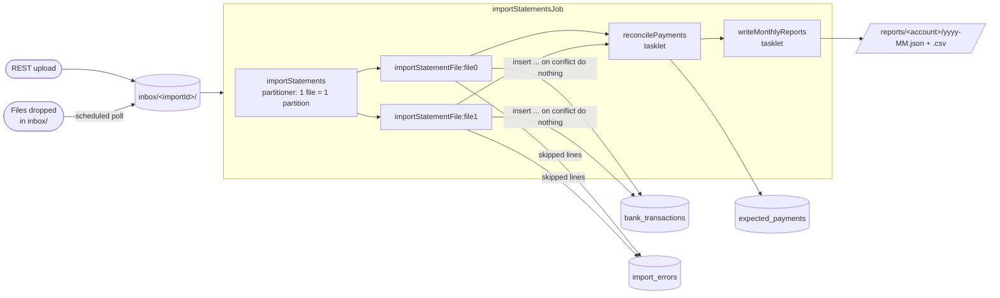

# Bank Statement Batch

[](https://github.com/Adri23Ausin/bank-statement-batch/actions/workflows/ci.yml)


A Spring Batch application that imports bank statement CSV files from different banks, **categorises** every transaction, **reconciles** them against the payments you expect (rent, bills, insurance) and writes **monthly reports** per account. Bad lines never sink an import: they are skipped and recorded with the reason. Re-importing a statement never creates duplicates, and every import can be followed through a REST API.

### Author: Adrián Ausín Cuesta

## Contents

1. [Features](#features)
2. [Tech stack](#tech-stack)
3. [How the job works](#how-the-job-works)
4. [Run it](#run-it)
5. [API](#api)
6. [Supported statement formats](#supported-statement-formats)
7. [Tests](#tests)
8. [Design decisions](#design-decisions)
9. [Possible improvements](#possible-improvements)

## Features

- **Multiple bank formats**, detected from the file header: Spanish exports (`dd/MM/yyyy`, decimal comma) and UK exports (ISO dates, separate debit/credit columns).
- **Partitioned, parallel import**: one partition per file, processed on virtual threads.
- **Fault tolerance**: malformed lines are skipped (up to a limit) and stored in `import_errors` with the line number, content and reason.
- **Idempotent imports**: each movement gets a SHA-256 fingerprint, so importing the same (or an overlapping) statement twice adds nothing. Two identical coffees on the same day are still kept as two transactions.
- **Rule-based categorisation** (groceries, housing, utilities...) with regex rules in `application.yml`.
- **Reconciliation** of expected payments: matched by reference or by unique amount within a date window. Ambiguous matches go to `REVIEW`, and payments missing from the statements become `OVERDUE`.
- **Monthly reports** per account in JSON and CSV, plus a REST endpoint.
- **REST API** to upload statements and follow each import, and **inbox polling** for files dropped into a folder (e.g. by SFTP).

## Tech stack

| Area | Technology |
|---|---|
| Language | Java 21 (records, sealed interfaces, pattern matching for `switch`, virtual threads) |
| Batch | Spring Batch 6 (chunk-oriented steps, partitioning, skip policy, step-scoped beans, JDBC job repository) |
| Framework | Spring Boot 4.1, Spring MVC, `JdbcClient` |
| Database | PostgreSQL 17, Flyway (including the Spring Batch metadata schema) |
| API docs | springdoc-openapi 3 |
| Tests | JUnit 5, AssertJ, `JobOperatorTestUtils`, `MockMvcTester`, Testcontainers |
| Build & delivery | Maven wrapper, multi-stage Docker image, Docker Compose, GitHub Actions |

## How the job works



Each worker step is a chunk-oriented step (500 lines per chunk):

| Stage | Class | What it does |
|---|---|---|
| Read | `FlatFileItemReader` + `StatementFormat` | Detects the bank format from the header and parses each line into a normalised `StatementLine` |
| Process | `BankTransactionProcessor` | Rejects future dates, categorises, computes the fingerprint |
| Write | `BankTransactionWriter` | Batch insert with `ON CONFLICT (fingerprint) DO NOTHING`, counting duplicates |
| Skip | `ImportErrorRecorder` | Stores each skipped line with its reason |

```
src/main/java/com/adrianausin/statements
├── parsing/          # StatementFormat (sealed: IberBank, NorthBank), CSV field splitting
├── categorization/   # Category, regex rules, TransactionCategorizer
├── importing/        # Job config, partitioner, processor, writer, launcher, inbox polling, status
├── reconciliation/   # PaymentReconciler and its step
├── reporting/        # Monthly report queries, file writer and step
└── api/              # REST controllers and problem-detail mapping
```

## Run it

Requires **Docker**. To run outside Docker you also need **JDK 21**.

### Everything in Docker

```bash
docker compose --profile app up --build
```

The service is at http://localhost:8080 and Swagger UI at http://localhost:8080/swagger-ui.html. Upload the sample statements:

```bash
curl -F "files=@samples/ES9121000418450200051332_2026-09.csv" \
     -F "files=@samples/GB33BUKB20201555555555_2026-09.csv" \
     localhost:8080/api/v1/imports
```

### Service on your machine, database in Docker

```bash
docker compose up -d postgres
./mvnw spring-boot:run        # macOS / Linux
.\mvnw.cmd spring-boot:run    # Windows
```

Set `INBOX_POLLING=true` to import any `.csv` dropped into `./inbox` every minute.

## API

[`requests.http`](requests.http) runs the whole flow from IntelliJ or VS Code.

| Method | Path | Description |
|---|---|---|
| `POST` | `/api/v1/imports` | Upload statement files (multipart `files`). Returns `202` with the `importId` |
| `GET` | `/api/v1/imports/{importId}` | Status, per-file counts (read, written, duplicates, skipped) and skipped lines |
| `GET` | `/api/v1/accounts/{accountId}/reports/{yyyy-MM}` | Monthly income, spending and totals by category |
| `GET` | `/api/v1/accounts/{accountId}/transactions?month=2026-09&category=GROCERIES` | Imported transactions |
| `POST` | `/api/v1/expected-payments` | Register a payment to reconcile |
| `GET` | `/api/v1/expected-payments?accountId=...&status=OVERDUE` | Expected payments and their status |

Example status of an import of both sample files:

```json
{
  "importId": "20261026-103512-4f1c2a9b",
  "status": "COMPLETED",
  "files": [
    {"file": "ES9121000418450200051332_2026-09.csv", "status": "COMPLETED", "read": 25, "written": 25, "duplicates": 0, "skipped": 2},
    {"file": "GB33BUKB20201555555555_2026-09.csv", "status": "COMPLETED", "read": 22, "written": 22, "duplicates": 0, "skipped": 2}
  ],
  "errors": [
    {"sourceFile": "ES9121000418450200051332_2026-09.csv", "lineNumber": 23, "line": "25/09/2026;COMPRA SIN IMPORTE;;EUR;685,70", "reason": "Invalid amount ''"},
    {"sourceFile": "ES9121000418450200051332_2026-09.csv", "lineNumber": 27, "line": "31/09/2026;FECHA IMPOSIBLE;-1,00;EUR;2.572,57", "reason": "Invalid date '31/09/2026'"}
  ]
}
```

## Supported statement formats

Files must be named `<IBAN>_<anything>.csv` (e.g. `ES9121000418450200051332_2026-09.csv`). The format is detected from the header line. Samples are in [`samples/`](samples), including a few invalid lines on purpose.

| Format | Header | Dates | Amounts |
|---|---|---|---|
| IberBank (Spain) | `Fecha;Concepto;Importe;Divisa;Saldo` | `dd/MM/yyyy` | Signed, decimal comma, dot thousands separator: `-1.234,56` |
| NorthBank (UK) | `Date,Description,Debit,Credit,Currency` | `yyyy-MM-dd` | Unsigned, separate debit and credit columns |

Quoted fields with delimiters or escaped quotes and a UTF-8 BOM are supported. To add a bank, add a permitted implementation of the sealed `StatementFormat` interface.

## Tests

```bash
./mvnw verify    # needs Docker running for Testcontainers
```

60 tests:

| Kind | What they cover |
|---|---|
| Unit tests | Both bank formats (valid and invalid lines, quoting, impossible dates), categorisation rules against the sample descriptions |
| Job tests (Testcontainers) | Partitioned import, skips and recorded errors, duplicate detection on re-import, identical same-day movements, a bad file failing only its own partition |
| Reconciliation tests | Match by reference, match by unique amount, `REVIEW` on ambiguity, `OVERDUE` vs `PENDING`, one transaction settling one payment |
| Report tests | Totals by category, JSON and CSV output |
| API tests | Upload, status polling, validation errors, inbox polling, reports and reconciliation over HTTP |

## Design decisions

- **Partition per file.** Files are independent, so each one is a partition: they run in parallel, and a file with an unknown format fails alone while the others are imported. A file is never split, because occurrence numbering (below) needs to see it in order.
- **Deduplication with a fingerprint, not a "file already imported" flag.** Banks export overlapping date ranges, so the same movement can arrive in two different files. The fingerprint (account, date, amount, currency, description, occurrence number) catches that, and `ON CONFLICT DO NOTHING` makes the write idempotent even under retries.
- **Occurrence numbers come from line numbers.** Two identical movements on the same day are numbered by their position in the file, not by a running counter. The number stays the same if a chunk is rolled back and processed again after a skip. It is also saved in the step's execution context, so a restarted import numbers the remaining lines exactly as before.
- **Strict parsing.** `31/09/2026` is rejected instead of quietly becoming 30 September (the JDK's default `SMART` resolver does that). Amounts are `BigDecimal`s and are never rounded.
- **No job incrementer.** In Spring Batch 6 an incrementer replaces the parameters given at launch. Each import passes its own `importId` instead, which also finds the job execution again for the status endpoint.
- **Spring Batch schema in Flyway.** The metadata tables are versioned with the rest of the database instead of being created at startup.
- **Reconciliation errs on the side of asking.** When two transactions could settle a payment and nothing tells them apart, the payment goes to `REVIEW` rather than being matched with a guess.

## Possible improvements

- Learn categories from user corrections, as well as from the regex rules.
- Currency conversion for multi-currency accounts.
- Restart failed imports from the API (`JobOperator.restart`).
- Read statements from object storage (S3) instead of the local file system.
- Metrics per import (lines per second, skip rate) with Micrometer.

## License

[MIT](LICENSE)
